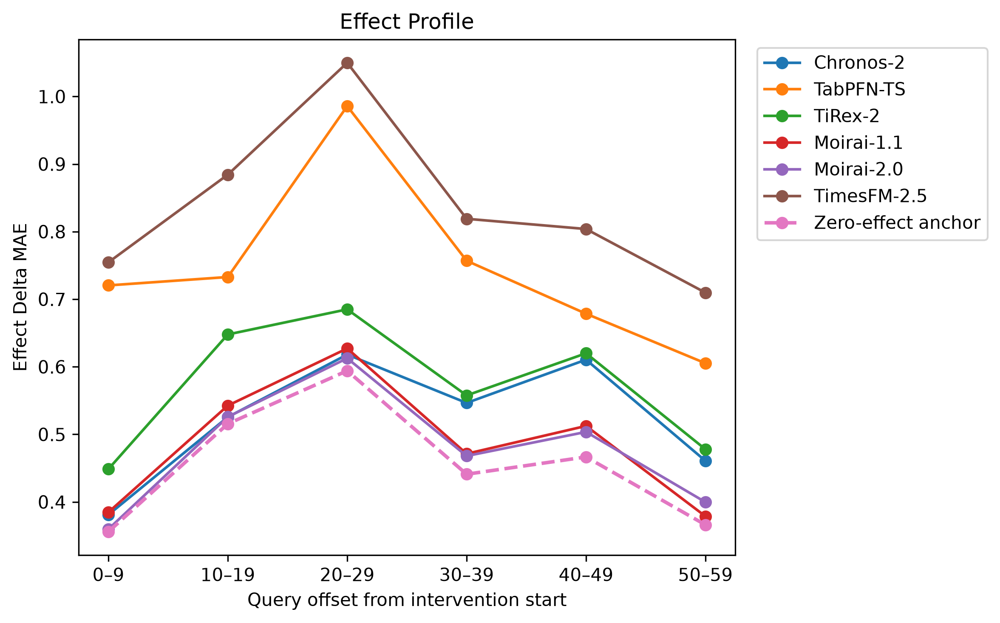
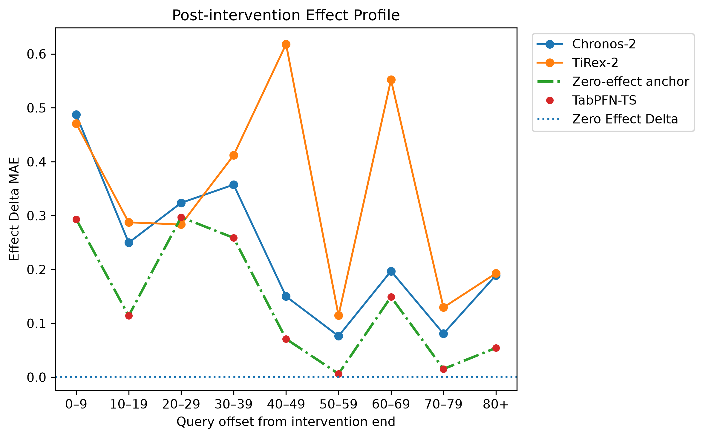

# Counterfactual probing of time-series foundation models

Code and results for the paper

> **From Temporal Foundation to World Models: Counterfactual Probing with Exact Ground Truth**<br>
> Maria Fernanda Aquino Freitas Scarcela, José Wellington Franco da Silva, Carlos Caminha (Universidade Federal do Ceará) and Dennis Thumm (National University of Singapore)<br>
> NeurIPS 2026 Workshop on Foundation Models for Temporal Systems (FMTS)

Time-series foundation models (TSFMs) increasingly accept known future
covariates, so a planned intervention can be handed to them through their
forecasting interface. This repository tests whether their forecasts respond
to that intervention correctly, by scoring the response against exact
counterfactual ground truth from the [DoTime](https://dotime.readthedocs.io)
benchmark.

## The probe

Each frozen model is queried twice on the same episode and the same
pre-intervention history:

- **P0**, the observational forecast, with no intervention supplied;
- **P1**, the intervention-conditioned forecast, with the treatment set to the
  do-value through the model's covariate channel.

The model's implied effect is `τ̂ = P1 − P0`, and it is compared with the true
effect `τ = Y_do − Y_obs` from DoTime's paired trajectories, which share their
noise realisation. Two metrics summarise the comparison:

| Metric | Question |
|---|---|
| **Usage Gap**, `mean(|τ̂|)` | Does the model react to the intervention at all? |
| **Effect Delta RMSE**, `RMSE(τ̂ − τ)` | Does the reaction match the true effect? |

Every result is read against a **zero-effect anchor**, the error of a
predictor that ignores the intervention. A model carries causal information
only if it falls below that anchor.

## Models

| Interface | Models |
|---|---|
| P1, native known-future covariates | Chronos-2, TabPFN-TS, TiRex-2, Moirai-1.1, Moirai-2.0 |
| P1\*, external regression path (XReg) | TimesFM-2.5 |
| P2, decode-time conditioning | Toto-1.0 (cannot reach the queried outcome; interface audit only) |
| No usable intervention channel | Chronos-Bolt, TiRex-1, Sundial |
| DoTime reference baselines | Static TabPFN, DoT-PFN |

## Benchmarks

| Suite | Version | Episodes used |
|---|---|---|
| `dot-Identifiability-v1` | 1.1.0, revision `03e33050` | 10,800 episodes over 8 identification structures; the headline uses the 5,165 with a nonzero true effect |
| `dot-Continuous-v1` | 1.0.0 | 1,000 non-self episodes per structure for each regime (in-window and post-window) |

In Identifiability the query falls at the intervention step, so 5,635
episodes have a true effect of exactly zero. They serve as null controls and
are reported per structure rather than pooled into the headline.

## Results at a glance

Identifiability, 5,165 nonzero-effect episodes (Table 1 of the paper):

| Model | Usage Gap | Effect Delta RMSE ↓ |
|---|---:|---:|
| Chronos-2 | 0.194 | **0.471** |
| TiRex-2 | 0.200 | 0.482 |
| TabPFN-TS | 0.185 | 0.504 |
| TimesFM-2.5 (XReg) | 0.482 | 0.565 |
| Moirai-2.0 | 0.007 | 0.674 |
| Moirai-1.1 | 0.032 | 0.676 |
| *Zero-effect anchor* | 0.000 | 0.674 |

Full tables with 95% bootstrap intervals are in
[`results/paper_artifacts/`](results/paper_artifacts/).

<p align="center">
  
  
</p>
<p align="center"><em>Figure 1. Effect Delta MAE by query offset on the Continuous suite, during (left) and after (right) the intervention.</em></p>

## Repository structure

```text
.
├── probe/                      # Probe harness
│   ├── adapters/               # One adapter per model, behind a common P0/P1 interface
│   ├── references/             # DoTime baselines and the Static TabPFN reference
│   ├── interfaces.py           # Episode parsing, query step, intervention window, P0/P1 calls
│   ├── filter.py               # Continuous episode selection
│   └── metrics.py              # Usage Gap, Effect Delta, direction, coverage, CRPS
├── run_probe.py                # TSFMs, zero-effect anchors and the oracle check
├── run_dotpfn.py               # DoT-PFN reference
├── run_tabpfn_adjustment.py    # Static TabPFN reference
├── aggregate_metrics.py        # Metrics and bootstrap intervals from the raw runs
├── notebooks/
│   ├── suites_overview.ipynb               # Checks on the two DoTime suites
│   └── fmts_workshop_tables_figures.ipynb  # Paper tables and Figure 1
├── results/
│   ├── selections/             # Frozen Continuous episode IDs (seed 42)
│   ├── metrics/                # Aggregated metrics
│   ├── paper_artifacts/        # Paper tables as CSV
│   └── figures/                # Figure 1, panels (a) and (b)
├── requirements.txt
├── install.sh
└── SETUP.md                    # Environment details and known dependency constraints
```

## Installation

The tested environment uses Python 3.12 and PyTorch 2.8.0 with CUDA 12.6.

```bash
python3.12 -m venv .venv
source .venv/bin/activate
bash install.sh
```

`install.sh` installs Toto and Uni2TS (Moirai) with `--no-deps` on purpose;
[`SETUP.md`](SETUP.md) explains why, and covers CPU-only installs and known
dependency warnings.

Some checkpoints are gated on Hugging Face (for example `NX-AI/TiRex-2`).
Accept the terms on the model page and authenticate with
`huggingface-cli login`, or keep `HF_TOKEN` in a local `.env` file, which is
git-ignored:

```bash
set -a; source .env; set +a
```

## Reproducing the paper

Run every command from the repository root. Benchmarks and checkpoints are
downloaded on first use.

**1. Run the models.** Completed runs are validated and skipped, so the
scripts can be resumed safely.

```bash
python run_probe.py                    # TSFMs, anchors and oracle, all protocols
python run_dotpfn.py                   # DoT-PFN reference, all protocols
python run_tabpfn_adjustment.py --full # Static TabPFN, all 10,800 Identifiability episodes
```

Raw predictions are written to `results/runs/<protocol>/`.

**2. Aggregate the metrics.**

```bash
python aggregate_metrics.py --population intersection --n-boot 10000 --seed 42
```

This writes to `results/metrics/`:

| File | Content |
|---|---|
| `summary_pooled.csv` | Pooled metrics per model and regime |
| `summary_pooled_nonzero.csv` | Identifiability, nonzero-effect episodes only (headline) |
| `summary_by_structure.csv` | Per causal structure |
| `summary_by_structure_nonzero.csv` | Per structure, nonzero-effect episodes only |
| `summary_by_horizon.csv` | Per forecast horizon |
| `duration_accrual.csv` | Continuous errors by intervention length |
| `per_episode.csv` | One row per model and episode, used by the Effect Profiles |

**3. Build the tables and figure.**

```bash
python -m pip install notebook matplotlib
jupyter notebook notebooks/fmts_workshop_tables_figures.ipynb
```

The notebook loads no model; it reads `results/metrics/` and writes the
tables to `results/paper_artifacts/` and Figure 1 to `results/figures/`.
`notebooks/suites_overview.ipynb` documents and checks the benchmark
properties the probe relies on.

### What is and is not versioned

The repository includes the frozen episode selections, the aggregated metrics,
the paper tables and the figure, so every table can be checked without
rerunning anything. The downloaded benchmark data (`data/`), the raw
predictions (`results/runs/`) and `results/metrics/per_episode.csv` are not
versioned because of their size; steps 1 and 2 regenerate them.

## Reproducibility settings

| Setting | Value |
|---|---|
| Identifiability | `dot-Identifiability-v1` v1.1.0, Hugging Face revision `03e33050` |
| Continuous | `dot-Continuous-v1` v1.0.0 |
| Continuous selection seed | 42 |
| Inference seeds | 42, 43, 44 for Moirai-1.1, the only stochastic model in the comparison |
| Bootstrap | 10,000 percentile resamples, seed 42 |
| Point forecast | predictive median (`q50`) when available |
| Hardware | AMD Ryzen 7 5700G, 31 GiB RAM, NVIDIA RTX 4060 Ti (16 GiB), Ubuntu 24.04 |

Every raw result records its benchmark version, episode IDs, inference seed,
package versions, model configuration and repository state.

## Citation

```bibtex
@inproceedings{scarcela2026counterfactual,
  title     = {From Temporal Foundation to World Models: Counterfactual Probing with Exact Ground Truth},
  author    = {Scarcela, Maria Fernanda Aquino Freitas and da Silva, Jos{\'e} Wellington Franco and Caminha, Carlos and Thumm, Dennis},
  booktitle = {NeurIPS 2026 Workshop on Foundation Models for Temporal Systems},
  year      = {2026}
}
```

Please also cite [DoTime](https://dotime.readthedocs.io) when using its benchmark suites.

## License

The code in this repository is released under the license in [`LICENSE`](LICENSE).
The DoTime benchmark suites are distributed under CC-BY-4.0. Each evaluated
model is subject to its own license (for example, TiRex models use the NXAI
Community License); check the model card before redistributing a checkpoint
or its outputs.
